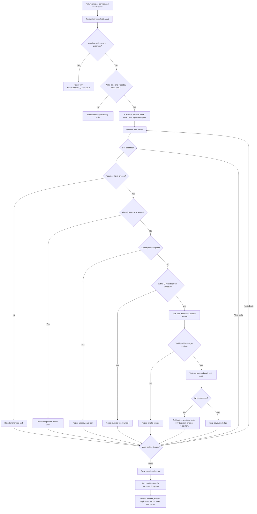

# Weekly Rewards Settlement — QA Assessment

An in-memory JavaScript assessment project for testing a weekly rewards settlement workflow. The focus is on payout correctness, duplicate prevention, UTC date boundaries, failure isolation, and recovery from interrupted or transiently failing work.

> **Scope note:** This repository is a test harness and mock service. It does not connect to a production database, payment provider, scheduler, queue, or notification service. Passing tests demonstrate behavior of this implementation in one process; they are not evidence of production-grade durability or cross-process safety.

## Getting started

### Requirements

- Node.js 20 or newer
- npm

### Install and run

From the project root:

```bash
npm install
npm test
```

The `test` script runs the settlement Playwright suite:

```bash
npm test
```

To run one test by its title:

```bash
npx playwright test tests/settlement.spec.js -g "happy path"
```

Playwright reports the result in the terminal. The tests run against the local in-memory service; no browser or external service is required by these tests. The suite also has a test-local faulty reference that is expected to fail its one-payout assertion. Playwright marks this demonstration as an expected failure; the corrected-service replay check must pass.

## Business rules under test

- A settlement run is allowed only on **Tuesday at 09:00:00 UTC**.
- A run covers the half-open weekly interval **[Monday 00:00 UTC, following Monday 00:00 UTC)**. The start is included; the end is excluded.
- Timestamp offsets are parsed as absolute instants and compared in UTC.
- A valid task earns **10 credits by default**. An explicit `rewardCredits` must be a positive safe integer.
- A task ID must not be paid more than once.
- Notification failures are reported separately and do not undo a committed payout.
- Tasks are processed in bounded chunks. The default chunk size is 500.

## Settlement flow



### How to read a test

The suite follows the standard **Arrange → Act → Assert** pattern:

1. **Arrange:** A Playwright fixture creates a fresh `SettlementService` and seeds a named batch of tasks. Some tests then replace a hook to simulate a failure, delay, or retryable error.
2. **Act:** The test triggers settlement through `SettlementServiceFacade`.
3. **Assert:** The test checks both the returned result and the service state: payout records, task statuses, ledger count, credit totals, errors, notifications, or cursor.

The facade is intentionally thin. It forwards settlement calls and gives tests readable methods such as `getCreditLedgerCount()` and `getTaskState()`. The rules themselves live in `src/settlementService.js`.

## Test coverage map

The test cases below are listed in their order in `tests/settlement.spec.js`.

| # | Scenario | Main behavior verified |
|---:|---|---|
| 1 | Happy path | Three eligible tasks are paid once; payout metadata, task states, ledger, and totals agree. Returned snapshots cannot mutate service state. |
| 2 | Lower time boundary | A task submitted exactly Monday 00:00 UTC is eligible. |
| 3 | Upper time boundary | A task just after Monday 00:00 UTC is eligible; one at the following Monday 00:00 UTC is not. |
| 4 | Time-zone offsets | Offset timestamps are converted to their UTC instants before the window check. |
| 5 | Duplicate IDs within a batch | Only the first task with a repeated ID is paid; the next is recorded as a duplicate. |
| 6 | Settlement replay | Repeating a completed settlement adds no payout or credits to the ledger. |
| 7 | Notification throws | The notification is marked failed, while the payout and paid task state remain committed. |
| 8 | Malformed tasks | Missing task IDs or submission times are rejected without preventing a valid task in the same batch from settling. |
| 9 | Invalid schedule | A run at the wrong time throws `INVALID_SETTLEMENT_SCHEDULE`; no payout is made and the task remains pending. |
| 10 | Concurrent settlement calls | A second call while the first is still processing receives `SETTLEMENT_CONFLICT`; the task is paid once. |
| 11 | Large batch | 10,001 tasks are paid in chunks of at most 500, with exact ledger count and credit total. |
| 12 | Already-paid task | A task initially marked `PAID` is rejected without a ledger entry. |
| 13 | HTTP 500 notification | The failed notification is reported independently; the committed payout remains in the ledger. |
| 14 | Poison-pill task | A simulated item-processing error rejects only that item; valid tasks before and after it still pay. |
| 15 | Fractional reward | Fractional rewards are rejected; valid integer rewards produce exact totals. |
| 16 | Deadlock and permanent write failure | Transient serialization errors are retried after rollback; a permanent write error leaves no payout, and other items continue. |
| 17 | Interrupted chunk and resume | After two chunks of ten, a retry resumes at item 20, pays the remaining 30 once, and rejects a changed input fingerprint. |

The 17 rows are behavior scenarios. In addition, the suite runs a deliberately faulty reference case that appends a payout on every attempt; its one-payout regression assertion is expected to fail. This controlled reference demonstrates that the regression condition detects duplicate payouts. It is not a historical or production implementation.

## Project structure

```text
.
├── fixtures/
│   └── settlementFixtures.js       # Playwright fixtures, service instances, and seeded task batches
├── pages/
│   └── SettlementServiceFacade.js  # Test-facing wrapper around the service
├── src/
│   └── settlementService.js        # Settlement rules and in-memory state
├── tests/
│   └── settlement.spec.js          # 17 behavior scenarios plus faulty-reference proof
├── settlement-test-case-document.md
├── settlement-test-case-document.xlsx
├── directive.md                    # Assessment scope and requirements
├── intent.md                       # Risk rationale and assumptions
└── package.json
```

## SDET notes: what the assertions protect

- **Check outcomes and state:** A returned payout alone is not enough. Tests also inspect task state and ledger totals to catch inconsistencies.
- **Use exact boundaries:** Equality at the inclusive start and exclusion at the exclusive end prevent off-by-one and timezone defects.
- **Assert no side effects on failure:** Invalid schedules and failed writes are checked for absent ledger entries or unchanged tasks.
- **Inject faults deterministically:** Hooks simulate concurrency, item errors, serialization failures, and interruptions without depending on flaky external systems.
- **Keep item failures isolated:** Tests confirm one bad task does not silently stop unrelated valid tasks.
- **Exercise idempotency at multiple levels:** Duplicate IDs, replay, concurrent calls, and resume are distinct paths and are tested separately.
- **Validate exact amounts:** Integer and `BigInt` totals help catch accidental rounding or floating-point arithmetic errors.

## Important limitations and production follow-up

The mock stores tasks, ledger entries, cursors, and the in-progress flag in memory. That is useful for deterministic unit-level regression tests but does not provide durable transactions, multi-process locking, or recovery after a process restart.

Before applying these guarantees to a production settlement system, validate them against the real persistence and integration boundaries. In particular, use durable unique constraints and atomic payout/task updates, define cross-worker idempotency, persist resumable progress, and separate reliable notification delivery from payout commit (for example, with a transactional outbox). Add integration and failure-injection tests against those production components.

For the detailed assessment rationale and test-case outcomes, see [`intent.md`](./intent.md), [`directive.md`](./directive.md), and [`settlement-test-case-document.md`](./settlement-test-case-document.md).
